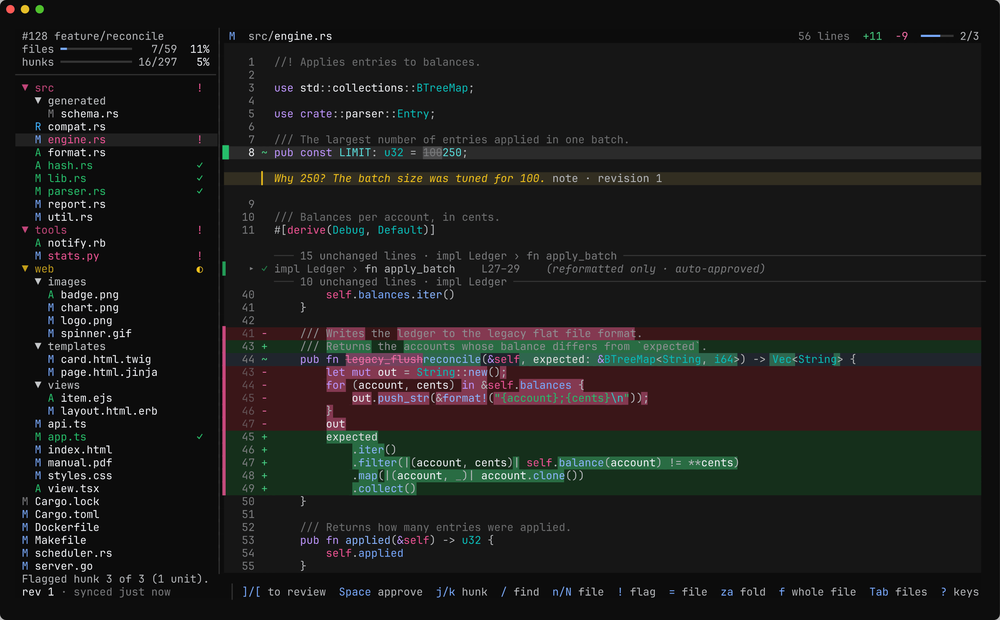
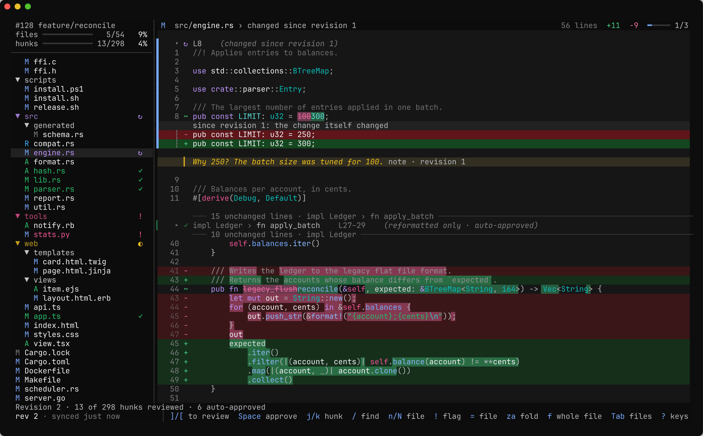
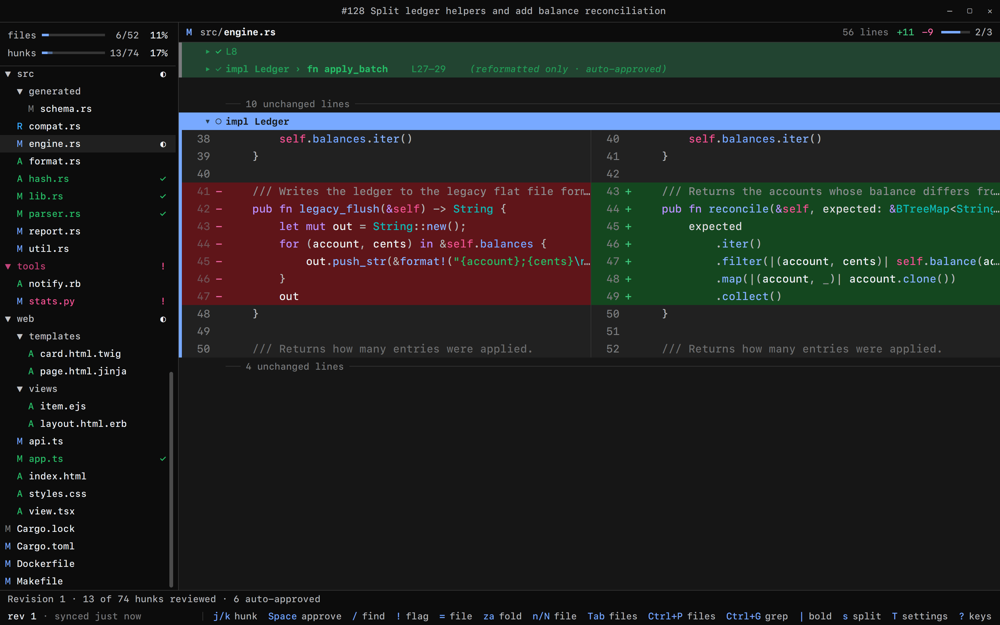
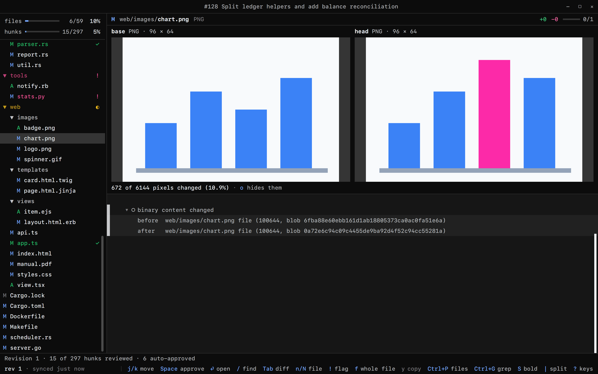
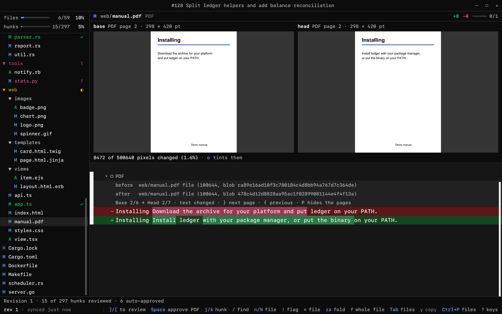

# code-review

[](https://github.com/romnn/code-review/actions/workflows/build.yaml)
[](https://github.com/romnn/code-review/actions/workflows/test.yaml)

A fast, native tool for reviewing **large, often AI-written diffs and GitHub pull requests**. It
remembers what you have reviewed down to the hunk, across pushes and force-pushes, and keeps
reformatting and moved code from drowning the real edits.

<p align="center">
  <br>
  <picture>
    <source media="(prefers-color-scheme: light)" srcset="https://raw.githubusercontent.com/romnn/code-review/main/docs/screenshots/tui/hero-light.png">
    
  </picture>
  <br>
  The terminal app (<code>cr</code>).
  <br><br>
</p>

- **Review state per hunk that survives pushes.** After a push, rebase or force-push, only new or
  changed hunks are unreviewed, and changed ones show what changed since you last saw them.
- **Reformatting is proven, not guessed.** Changes that only touch whitespace, indentation or line
  wrapping are checked over tree-sitter syntax trees, folded away and approved automatically; real
  edits inside reformatted code stay visible.
- **Moves are detected**, within and across files, and shown as one line with their edits.
- **Every common file type is highlighted**: about thirty languages with tree-sitter and Helix's
  queries, everything else with bat's syntaxes, code fenced in Markdown included. Templates
  (Helm charts, Go templates, Jinja, ERB, EJS and Twig) highlight their text as the file they
  produce, such as `values.yaml.gotmpl` as YAML.
- **Flag and annotate hunks**, then export them as Markdown or JSON to hand back to Claude or
  Codex. Agents can drive the `cr` CLI directly.
- **Never pretends.** When identity, equivalence or a move is ambiguous, the code is reopened or
  shown in full: the tool never makes you believe you reviewed code you did not.

One engine, three front ends: a terminal app, a desktop app and a CLI, sharing the same keys,
configuration and review state.

## Install

```bash
brew install --cask romnn/tap/code-review
```

This installs `cr` on macOS and Linux. Prebuilt binaries for macOS, Linux and Windows are on the
[releases page](https://github.com/romnn/code-review/releases).

From source:

```bash
cargo install --locked --git https://github.com/romnn/code-review review-cli
```

The build fetches the tree-sitter grammars and Helix queries it highlights with from upstream, at
the commits Helix pins, and the prebuilt [pdfium](https://github.com/bblanchon/pdfium-binaries)
it reads changed PDFs with, so it needs `git`, a C and C++ compiler, and network. To build
offline, set `PDFIUM_LIB_DIR` to the directory holding that pdfium release's library for the
target (`lib/`, `bin/` on Windows), or build without PDF support with `--no-default-features`.

The desktop app, `review-gui`, is not released yet. Build it from source with
`cargo install --locked --git https://github.com/romnn/code-review review-gui`; on Linux it needs
Wayland, a Vulkan driver, `libxkbcommon` and `fontconfig`.

## Quick start

Run it in a repository:

```bash
cr              # this checkout, whatever is checked out, against the default branch
cr 128          # a pull request by number or URL (needs the GitHub CLI, `gh`)
cr main..HEAD   # a range
cr --worktree   # uncommitted and untracked changes, such as an agent's last turn
cr --demo       # a built-in demo review to try it out
```

A review of uncommitted work follows the working tree as it changes, as lazygit does: an edit
shows within a second, keeping your place, and only what you mark is recorded.

`review-gui` takes the same arguments. Press `?` for every key. The essentials:

| Key | Action |
|---|---|
| `j` / `k` | Next / previous file; in the diff, next / previous hunk |
| `]` / `[` | Next / previous hunk to review |
| `n` / `N` | Next / previous file, from the files or the diff |
| `Ctrl+D` / `Ctrl+U`, `s` or `a` | Scroll half a page; scroll mode, where `j` / `k` scroll a line |
| `0`, `Tab` | Focus the diff, switch between files and code |
| `Space` | Approve or unapprove the hunk, file or folder |
| `!` | Flag as needing review |
| `u` | Back to unreviewed |
| `=` | The whole file, with vim motions and `gd` to go to definition |
| `y`, right click | Copy the text selected with the mouse; `Y` copies the hunk's unit ID |
| `/`, `Ctrl+P`, `Ctrl+G` | Find in the diff, find a file, search file contents |
| `f`, `v` | The whole file around its changes, or each hunk apart |
| `w` | Wrap long lines, or cut them and pan sideways |
| `o` | On a changed image, tint the pixels that changed |
| `}`, `{`, `P` | On a changed PDF, the next or previous page, and hide or show the rendered pages |
| `\|`, `S` | Side by side or unified, next diff style |
| `T` | Settings: themes, diff styles, density, layout |
| `i` | Pull request overview |
| `q` | Quit |

## The terminal app

`cr` runs anywhere a terminal does, over SSH included, as a single binary. A changed PDF shows
the extracted text of one page pair at a time, compared exactly and in order, under a page
navigator that `}` and `{` step through. In kitty, Ghostty and WezTerm, and in tmux with
`allow-passthrough` in kitty and Ghostty, a changed image shows its two versions side by side,
as in the desktop app, and so does a PDF's page pair, which `P` hides.
The Linux release is a static binary built without PDF support, where a PDF is a binary file.

<p align="center">
  <br>
  <picture>
    <source media="(prefers-color-scheme: light)" srcset="https://raw.githubusercontent.com/romnn/code-review/main/docs/screenshots/tui/revision-2-light.png">
    
  </picture>
  <br>
  The terminal app (<code>cr</code>) after a force-push.
  <br><br>
</p>

## The desktop app

`review-gui` is a native gpui app with smooth scrolling, mouse selection and a settings panel.

<p align="center">
  <br>
  <picture>
    <source media="(prefers-color-scheme: light)" srcset="https://raw.githubusercontent.com/romnn/code-review/main/docs/screenshots/gui/side-by-side-light.png">
    
  </picture>
  <br>
  The desktop app (<code>review-gui</code>) showing a diff side by side.
  <br><br>
</p>

A changed image shows its base and head side by side, and `o` tints the pixels that changed.
A changed PDF shows its selected page pair rendered the same way above the diff of the pages'
extracted text, its changed words marked; `}` and `{` step through the pages, and `P` hides the
rendered pair. Both are one unit to approve.

<p align="center">
  <br>
  <picture>
    <source media="(prefers-color-scheme: light)" srcset="https://raw.githubusercontent.com/romnn/code-review/main/docs/screenshots/gui/image-compare-light.png">
    
  </picture>
  <br>
  A changed image, its changed pixels tinted.
  <br><br>
</p>

<p align="center">
  <br>
  <picture>
    <source media="(prefers-color-scheme: light)" srcset="https://raw.githubusercontent.com/romnn/code-review/main/docs/screenshots/gui/pdf-compare-light.png">
    
  </picture>
  <br>
  A changed PDF on its changed page pair.
  <br><br>
</p>

## Commands for scripts and agents

`cr`'s commands drive the same reviews from scripts and agents, with `--json` output. They act
on this checkout's review, or on the one `--review <key>` names, such as the key `cr open 128`
prints. `cr show` prints unit IDs with the review's tag, and marks take them back as printed, so
an ID from one review never marks another's:

```bash
cr open              # record what this checkout holds
cr status            # counts per file and in total
cr show              # render the changes, step by step: u1-0003@3fa2b1c0, ...
cr mark u1-0003@3fa2b1c0 accepted   # seen, accepted, flagged or unseen
cr note u1-0003@3fa2b1c0 "Why 250?"
cr mark --file src --revision 1@3fa2b1c0 seen   # every unit below src in the revision shown
cr export            # flagged, accepted and annotated units, for an agent
```

## License

The engine (`review-core`) is licensed under either of
[Apache License, Version 2.0](LICENSE-APACHE) or [MIT license](LICENSE-MIT) at your option. The
shared app model (`review-ui`), the apps and `cr`, which contains the terminal app, are licensed
under [GPL-3.0-or-later](crates/review-ui/LICENSE).

Syntax highlighting embeds third-party definitions under their own licenses: tree-sitter
grammars, the tree-sitter queries of [Helix](https://github.com/helix-editor/helix) (MPL-2.0),
embedded unmodified at the commit `crates/review-languages/languages.toml` names, Jinja queries
derived from the Jinja grammar's (Apache-2.0), and the syntaxes the
[bat](https://github.com/sharkdp/bat) project curates. Their notices are collected in
[THIRD-PARTY-SYNTAXES](THIRD-PARTY-SYNTAXES), which release archives ship next to `cr`. The macOS
and Windows releases embed pdfium, whose notices are in [THIRD-PARTY-PDFIUM](THIRD-PARTY-PDFIUM).
