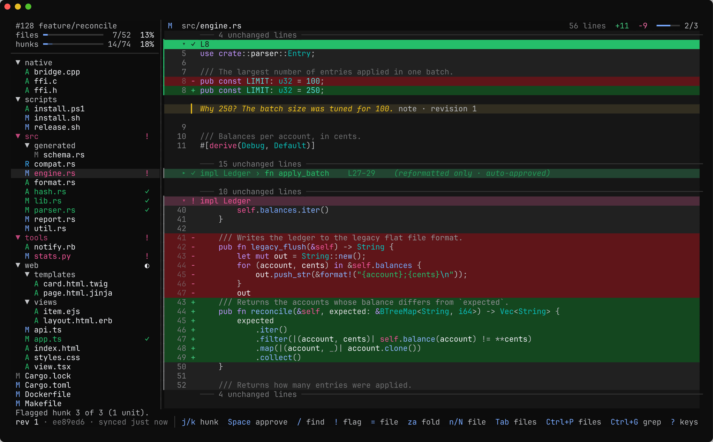
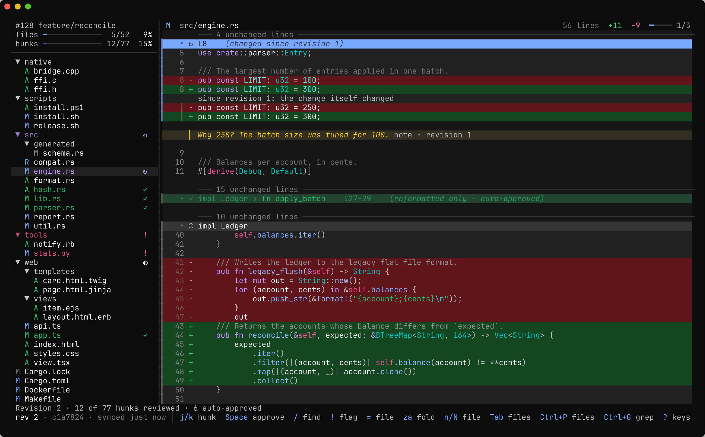
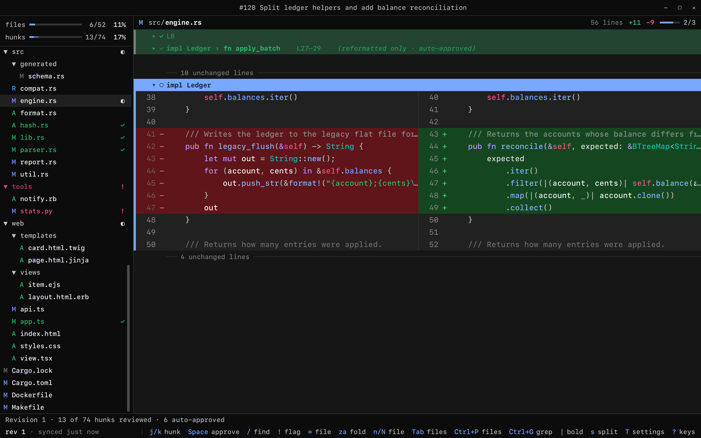

# code-review

[](https://github.com/romnn/code-review/actions/workflows/build.yaml)
[](https://github.com/romnn/code-review/actions/workflows/test.yaml)

A fast, native tool for reviewing **large, often AI-written diffs and GitHub pull requests**. It
remembers what you have reviewed down to the hunk, across pushes and force-pushes, and keeps
reformatting and moved code from drowning the real edits.

<p align="center">
  <br>
  <picture>
    <source media="(prefers-color-scheme: light)" srcset="https://raw.githubusercontent.com/romnn/code-review/main/docs/screenshots/tui/hero-light.png">
    
  </picture>
  <br>
  The terminal app (<code>cr</code>).
  <br><br>
</p>

- **Review state per hunk that survives pushes.** After a push, rebase or force-push, only new or
  changed hunks are unreviewed, and changed ones show what changed since you last saw them.
- **Reformatting is proven, not guessed.** Changes that only touch whitespace, indentation or line
  wrapping are checked over tree-sitter syntax trees, folded away and approved automatically; real
  edits inside reformatted code stay visible.
- **Moves are detected**, within and across files, and shown as one line with their edits.
- **Flag and annotate hunks**, then export them as Markdown or JSON to hand back to Claude or
  Codex. Agents can drive the `cr` CLI directly.
- **Never pretends.** When identity, equivalence or a move is ambiguous, the code is reopened or
  shown in full: the tool never makes you believe you reviewed code you did not.

One engine, three front ends: a terminal app, a desktop app and a CLI, sharing the same keys,
configuration and review state.

## Install

```bash
brew install --cask romnn/tap/code-review
```

This installs `cr` on macOS and Linux. Prebuilt binaries for macOS, Linux and Windows are on the
[releases page](https://github.com/romnn/code-review/releases).

From source:

```bash
cargo install --locked --git https://github.com/romnn/code-review review-cli
```

The desktop app, `review-gui`, is not released yet. Build it from source with
`cargo install --locked --git https://github.com/romnn/code-review review-gui`; on Linux it needs
Wayland, a Vulkan driver, `libxkbcommon` and `fontconfig`.

## Quick start

Run it in a repository:

```bash
cr              # the branch's open pull request, its uncommitted work, or <default branch>..<branch>
cr 128          # a pull request by number or URL (needs the GitHub CLI, `gh`)
cr main..HEAD   # a range
cr --worktree   # uncommitted and untracked changes, such as an agent's last turn
cr --demo       # a built-in demo review to try it out
```

`review-gui` takes the same arguments. Press `?` for every key. The essentials:

| Key | Action |
|---|---|
| `j` / `k` | Next / previous file or hunk |
| `0`, `Tab` | Focus the diff, switch between files and code |
| `Space` | Approve or unapprove the hunk, file or folder |
| `!` | Flag as needing review |
| `u` | Back to unreviewed |
| `=` | The whole file, with vim motions and `gd` to go to definition |
| `/`, `Ctrl+P`, `Ctrl+G` | Find in the diff, find a file, search file contents |
| `s`, `\|` | Side by side or unified, next diff style |
| `T` | Settings: themes, diff styles, density, layout |
| `i` | Pull request overview |
| `q` | Quit |

## The terminal app

`cr` runs anywhere a terminal does, over SSH included, as a single static binary.

<p align="center">
  <br>
  <picture>
    <source media="(prefers-color-scheme: light)" srcset="https://raw.githubusercontent.com/romnn/code-review/main/docs/screenshots/tui/revision-2-light.png">
    
  </picture>
  <br>
  The terminal app (<code>cr</code>) after a force-push.
  <br><br>
</p>

## The desktop app

`review-gui` is a native gpui app with smooth scrolling, mouse selection and a settings panel.

<p align="center">
  <br>
  <picture>
    <source media="(prefers-color-scheme: light)" srcset="https://raw.githubusercontent.com/romnn/code-review/main/docs/screenshots/gui/side-by-side-light.png">
    
  </picture>
  <br>
  The desktop app (<code>review-gui</code>) showing a diff side by side.
  <br><br>
</p>

## Commands for scripts and agents

`cr`'s commands drive the same reviews from scripts and agents, with `--json` output:

```bash
cr open 128          # start or refresh a review
cr status            # counts per file and in total
cr show              # render the changes, step by step
cr mark u1-0003 accepted   # seen, accepted, flagged or unseen
cr note u1-0003 "Why 250?"
cr export            # flagged, accepted and annotated units, for an agent
```

## License

The engine (`review-core`) is licensed under either of
[Apache License, Version 2.0](LICENSE-APACHE) or [MIT license](LICENSE-MIT) at your option. The
shared app model (`review-ui`), the apps and `cr`, which contains the terminal app, are licensed
under [GPL-3.0-or-later](crates/review-ui/LICENSE), because they include syntax highlighting
queries from [Zed](https://github.com/zed-industries/zed).
